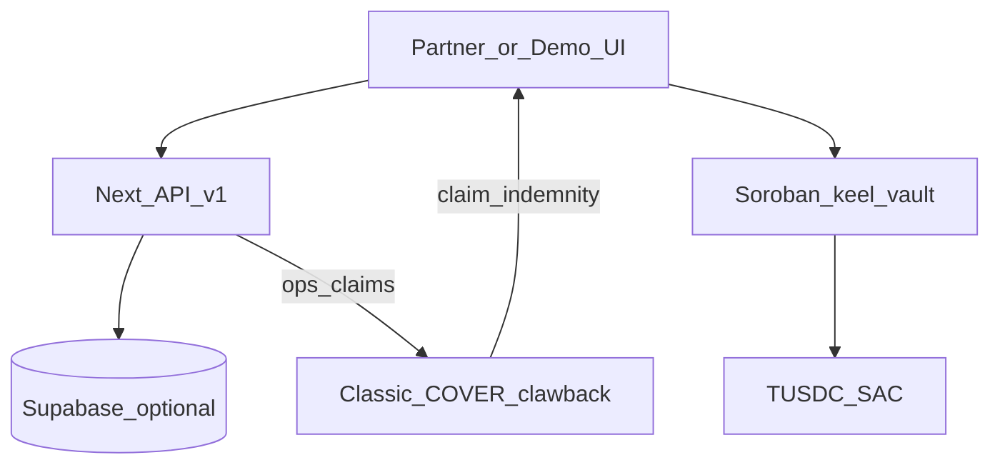

# Keel — Architecture (hackathon)

**Updated:** 2026-10-25

## What Stellar is used for

Keel is **transfer insurance** (covered balances) on Stellar Testnet.

| Layer | Role |
|-------|------|
| **Soroban `keel-vault`** | Policy ledger: deposit, transfer→unsettled window, settle, unwrap, exit pool, dispute/resolve, pause, `por()` |
| **Classic COVER asset** | Claims rail: issuer with `AUTH_CLAWBACK_ENABLED` — clawback holder + remint claimant |
| **SAC (Stellar Asset Contract)** | Wrap COVER + TUSDC (USDC stand-in) for contract transfers/mint |
| **TUSDC** | Testnet collateral stand-in for Circle USDC (swap when faucet-funded) |

No anchors or Freighter required for the Genesis demo (infra / technical demo path).

## Diagram

## Live Testnet IDs

Source of truth: [`testnet.addresses.json`](./testnet.addresses.json)

| Component | ID |
|-----------|-----|
| Policy vault | `CCQEAW5T6LFIANNOYFVIATYYXBEOERAXGCGRLLSHBQDU6XSCCJCOHL5J` |
| COVER SAC | `CAZGFSWXBWZIOZGRV42GXEKLZTP7MCJ74LVJZ6UYLHAOVHT52NMNP5Z2` |
| COVER issuer | `GCIYYORXS2E3LVSEZTVTVUNQQVX5YIJFNQFJCGR73GY234OBU3MPYC4P` |
| Network | Testnet · RPC `https://soroban-testnet.stellar.org` |

Explorers: see JSON `explorer` fields.

## Off-chain

| Piece | Purpose |
|-------|---------|
| Next.js app (`/demo`, `/ops`, `/por`, `/integrate`) | Demo + partner docs |
| `/api/v1/*` | Session engine API (faucet/deposit/transfer/claim/exit) |
| `@keel/sdk` | Embeddable Safe Mode / cover helpers |
| Supabase (`supabase/migrations`) | Optional persistence for sessions + claim audit |
| `.data/sessions.json` | Local fallback when Supabase env unset |

## APIs

| Endpoint | Use |
|----------|-----|
| `GET /api/v1/health` | Liveness |
| `GET /api/v1/network` | Published addresses + hackathon entry + cover smoke |
| `GET /api/v1/openapi` | OpenAPI surface |
| `POST /api/v1/sessions` | Create demo session |
| `POST /api/v1/sessions/:id/actions` | deposit / transfer / dispute / resolve / exit / … |
| `GET /api/v1/sessions/:id/por` | Signed PoR |
| `POST /api/v1/por/verify` | Verify PoR HMAC |

## Security notes

- Demo roles (`ops_*`) are strings — prod = multisig ([`MULTISIG.md`](./MULTISIG.md)).
- Clawback is **claims execution**, not a retail “we seize funds” product.
- Peg invariant: `vault_USDC ≥ covered_supply`.
