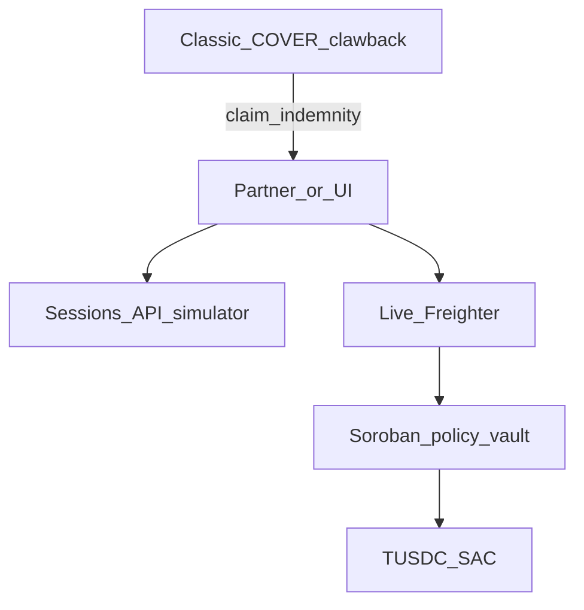

# Bind — Architecture (Genesis / Stellar Unlocked)

**Updated:** 2026-10-25  
**Track thesis:** [`UNLOCKED.md`](./UNLOCKED.md)

## What Stellar is used for

Bind is **DeFi deposit insurance** for protocols. Product language = cover / retention / claim.  
**Unlocked mechanic** = Classic clawback + Soroban policy vault + SACs.

| Layer | Role |
|-------|------|
| **Soroban `keel-vault`** | Policy ledger: deposit, transfer→unsettled window, settle, unwrap, exit pool, dispute/resolve, pause, `por()`, `credits`, `lots_of` |
| **Classic COVER asset** | Claims rail: issuer with `AUTH_CLAWBACK_ENABLED` — clawback holder + remint claimant |
| **SAC** | TUSDC (USDC stand-in) + COVER as contract-callable assets |
| **Freighter** | Signs `/live` vault txs (demo UX) |

No anchors required. Sessions API is a **simulator**; chain path is `/api/v1/chain/*`.

## Diagram

## Live Testnet IDs

Source of truth: [`testnet.addresses.json`](./testnet.addresses.json)

| Component | Notes |
|-----------|--------|
| Policy vault | `vault` field — **CDGNKK…** created **2026-10-25** |
| Prior vault (retired) | `retiredPrior.vault` — **CCQEAW…** created **2026-10-18** |
| COVER SAC / issuer | `cover.*` — clawback smoke **2026-10-25** |
| Network | Testnet · `https://soroban-testnet.stellar.org` |

## Off-chain

| Piece | Purpose |
|-------|---------|
| `/demo`, `/ops` | Simulator + claims desk UI |
| `/live`, `/por` | Freighter vault + on-chain PoR / COVER evidence |
| `/docs`, `/llms.txt` | Product + LLM docs |
| `/api/v1/sessions/*` | Simulator only — **not** custody |
| `/api/v1/chain/*` | prepare / submit / por / faucet / resolve |

## Public surfaces

- App: https://bind-beta.vercel.app  
- Repo: https://github.com/wrever/bind  
